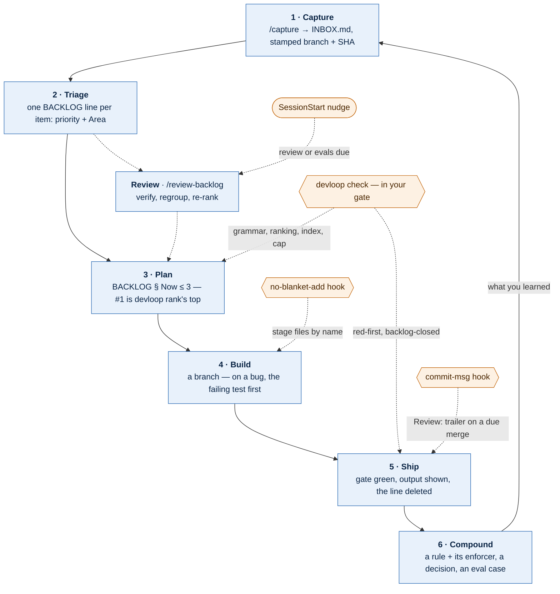

# devloop

A capture-to-ship development loop for any git repository agents work in — code, infrastructure or docs — with checks and hooks that enforce its rules.

Agents forget prose rules. They leave the fixed bug's line in the backlog "for when it merges", bury the oldest item under whatever they touched last, and ship a fix with a test written to agree with it. devloop turns each of those rules into something that fails: a check in your gate, a git hook, or a nudge at session start. The repository keeps only its documents and one `loop.toml`; the checks run from this plugin and read it, so there are no copies to drift.

<!-- BEGIN AUTOGEN:overview (managed by skillsmith --update-components; edits overwritten) -->
## What's inside

A capture-to-ship development loop for any git repository agents work in: loop documents, one config file, and checks and hooks that enforce the rules.

**At a glance:** 1 skill · 3 commands · 2 hooks

## Install

```
/plugin marketplace add totallyGreg/claude-mp
/plugin install devloop@totally-tools
```
<!-- END AUTOGEN:overview -->

## The loop

Every step ends in a committed document the next step reads, and every arrow that can be checked is checked.



Blue boxes are the steps; orange shapes are what enforces them. A **check** fails the gate, a **hook** blocks the action, a **nudge** only says something is due — and never fails a session start.

| Step | What changes hands | Enforced by |
|------|--------------------|-------------|
| Capture | A line in INBOX § Open, committed alone; no triage | `/capture` |
| Triage | INBOX line → one BACKLOG § Work item (priority P0–P3, Areas), deleted from INBOX | loop check: struck or "done" lines fail |
| Review | Backlog verified against git, regrouped, re-ranked, `Reviewed:` set | SessionStart nudge says when |
| Plan | § Now rewritten: ≤ 3 items, #1 is the ranked next or says why | loop check + ranking |
| Build | A branch; on a bug, the failing test committed alone first | `red-first` (software profile) |
| Ship | Gate green; the item leaves its list in the same commit | `backlog-closed`, stage `## Steps` check |
| Compound | A rule in AGENTS.md naming its enforcer; evals for judgment | doc index + size cap; evals-due nudge |

## Tiers

Turn on only what the repository has earned. `/devloop-init` asks.

| Tier | Adds | For |
|------|------|-----|
| 0 | `loop.toml`, AGENTS.md (index, capped to one page), INBOX.md, `/capture`, no-blanket-add | Any repository |
| 1 | BACKLOG, PLAN, DECISIONS, LOOP; loop check, ranking, review-due | Multi-month work |
| 2 | The software profile's review gate and config evals | When it has earned it |

`kind = "software"` adds **red-first** (a bugfix branch's first commit is the failing test alone, and it really fails there) and **backlog-closed** (the fix deletes its backlog line). Tier 2 adds the **review gate** — a merge into main that is large or risky needs a read-only `/code-review` from a fresh session and a `Review:` trailer — and **evals**, which replay past bug fixes under today's AGENTS.md to catch prose that reads well but steers agents worse.

## Quickstart

```
/devloop-init                      # loop.toml + the documents for your tier; never overwrites
/capture the export drops the last row
/review-backlog                    # when the session start says it's due
```

Then add the checks to the repository's gate (init prints this line; it never edits your build files):

```bash
"$(git config devloop.root)"/skills/devloop/scripts/devloop.py check
```

A failing check names the file, the line and the fix:

```
[2/4] loop
  FAIL  BACKLOG.md:44: unknown Area 'Bogus' — loop.toml `areas` lists the known ones
[3/4] red-first
  FAIL  red-first: the tests pass at the red commit f837506 — they don't reproduce the bug.
```

Other entry points: `devloop.py rank` (what next), `review-needed <base> <tip>`, `review`, `evals [<id> …]`. Every `loop.toml` key: `skills/devloop/references/loop-toml.md`.

## Hooks

- **`no_blanket_add.py`** (PreToolUse, Bash) blocks `git add .`, `-A`, `-u` and `git commit -a`, including behind `git -C`, `rtk` or `&&`. Standard library only, Python 3.9-safe; a malformed payload passes.
- **`devloop.py nudge`** (SessionStart) acts only in a repository with `loop.toml`: it points `git config devloop.root` at the installed plugin (so git hooks and the gate find it after an update) and prints when a backlog review or config evals are due. It always exits 0.

## Design rules

1. **Mechanism over prose.** A rule git or a script can check ships as a check or a hook.
2. **One always-loaded page.** AGENTS.md is the index, the commands and one line per rule naming its enforcer; a size cap keeps it one page.
3. **Configuration, not copies.** Checks run from the plugin and read `loop.toml`; `schema` in it makes a newer plugin refuse documents it doesn't understand.
4. **The commit is the postmortem.** No resolved-issues file.
5. **State outside the tree.** Worktrees, reviews and eval results live in `$XDG_CACHE_HOME/devloop/<repo>/`.

Packaged from AudiobookOCD's loop and checked against it (same failures on 14 planted defects, same review verdicts on 25 merges). Design: `docs/plans/2026-11-08-001-feat-devloop-plan.md`. Next: tracker backends (GitHub, GitLab) and a Jujutsu backend — [#235](https://github.com/totallyGreg/claude-mp/issues/235).

<!-- BEGIN AUTOGEN:components (managed by skillsmith --update-components; edits overwritten) -->
## Components

### Skills (1)

| Skill | Description |
|-------|-------|
| `devloop` | A development loop for any git repository where agents do the work. |

### Commands (3)

| Command | Description |
|-------|-------|
| `/capture` | Capture an idea or bug into the repo's INBOX without breaking stride |
| `/devloop-init` | Set up the devloop in this git repository — loop.toml and the loop documents |
| `/review-backlog` | Review the backlog — verify, regroup, re-rank, rewrite Now |

### Hooks (2)

| Hook | Trigger | Purpose |
|-------|-------|-------|
| `no_blanket_add.py` | PreToolUse Bash |  |
| `devloop.py` | SessionStart |  |
<!-- END AUTOGEN:components -->

## Changelog

| Version | Changes |
|---------|---------|
| 0.1.0 | New plugin: core (loop skill, init, `/capture`, `/review-backlog`, loop/doc checks, ranking, review-due, no-blanket-add) and the `software` profile (red-first, backlog-closed, review gate, evals) |

## Skill: devloop

### Current Metrics

**Score: 98/100** (Excellent) — 2026-11-08

| Concs | Complx | Spec | Progr | Descr |
|-------|--------|------|-------|-------|
| 100 | 90 | 100 | 100 | 100 |

### Version History

| Version | Date | Issue | Summary | Concs | Complx | Spec | Progr | Descr | Score |
|---------|------|-------|---------|-------|--------|------|-------|-------|-------|
| 0.1.0 | 2026-11-08 | [#235](https://github.com/totallyGreg/claude-mp/issues/235) | New skill: the loop, its documents and grammars, loop.toml, the software profile | 100 | 90 | 100 | 100 | 100 | 98 |
